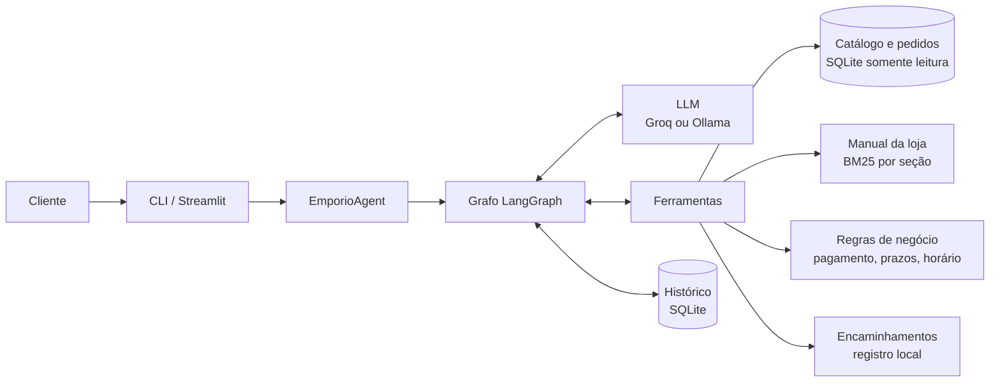

# Empório da Música · agente de atendimento

[](https://github.com/JFcamp/emporio-agent/actions/workflows/ci.yml)

Protótipo da **Lia**, assistente virtual de uma loja de instrumentos musicais em Campo Grande/MS. Ela atende por texto: responde sobre catálogo, preços e promoções, simula formas de pagamento, consulta pedidos, avalia pedidos de troca e devolução e encaminha para a equipe o que não consegue resolver.

Desenvolvido como desafio técnico para a vaga de AI Engineer na Artefact.

## Sumário

1. [Como rodar](#como-rodar)

2. [Arquitetura](#arquitetura)

3. [Decisões técnicas](#decisões-técnicas)

4. [Tratamento dos dados e suposições](#tratamento-dos-dados-e-suposições)

5. [Qualidade: testes e avaliação](#qualidade-testes-e-avaliação)

6. [Estrutura do repositório](#estrutura-do-repositório)

7. [Limitações e próximos passos](#limitações-e-próximos-passos)

8. [Uso de assistentes de IA](#uso-de-assistentes-de-ia)

## Como rodar

Requisitos: Python 3.11 ou superior e uma das duas opções de modelo, ambas gratuitas.

```bash

git clone https://github.com/JFcamp/emporio-agent.git

cd emporio-agent

python -m venv .venv

source .venv/bin/activate          # Windows: .venv\Scripts\activate

pip install -e ".[dev,web]"

cp .env.example .env               # Windows: copy .env.example .env

```

**Groq (recomendado):** crie uma chave em <https://console.groq.com/keys> e preencha `GROQ_API_KEY` no `.env`. O modelo padrão é `openai/gpt-oss-120b`.

**Ollama (100% local):** instale o [Ollama](https://ollama.com), rode `ollama pull qwen3:8b` e defina `LLM_PROVIDER=ollama` no `.env`.

```bash

python -m emporio.interfaces.cli                 # conversa no terminal (--debug mostra as ferramentas)

streamlit run src/emporio/interfaces/web.py      # interface web

pytest -q                                        # testes, sem LLM e sem rede

python -m evals.run                              # avaliação com o modelo real

python scripts/generate_examples.py              # regenera as conversas de examples/

```

O banco e o índice do manual são gerados automaticamente na primeira execução (ou com `python -m emporio.bootstrap`). Quem tem `make` pode usar `make chat`, `make web`, `make test`, `make evals` e `make examples`.

Com Docker: `docker build -t emporio-agent .` e `docker run --rm -it --env-file .env emporio-agent`.

Na CLI, `/novo` abre outra conversa, `/debug` liga e desliga a exibição das ferramentas e `/sair` encerra. Cada conversa tem um id, e `python -m emporio.interfaces.cli -t <id>` retoma uma conversa salva.

No plano gratuito do Groq há um limite diário de tokens. A suíte completa de avaliação consome boa parte dele; se o limite for atingido, o runner para, marca os casos restantes como não executados e permite retomar depois com `python -m evals.run --rerun-failed`.

## Arquitetura



Um turno de conversa funciona assim:

1. A mensagem entra no grafo junto com o histórico daquela conversa, salvo em SQLite.

2. O system prompt é montado na hora, com persona e regras fixas mais o contexto do momento: data e hora em Campo Grande, se a loja está aberta, endereço, contato, horário e as categorias com a quantidade de produtos ativos.

3. Antes de chamar o modelo, o histórico passa por uma limpeza (remove chamadas de ferramenta sem resposta, que fariam o provedor recusar o turno) e é cortado para as mensagens mais recentes, sem perder a pergunta atual.

4. O modelo responde direto ou pede ferramentas. O ciclo modelo → ferramenta → modelo se repete até a resposta final, com limite de passos.

5. As ferramentas devolvem JSON já formatado e, quando faz sentido, uma frase pronta para o cliente `resumo`). A resposta final passa por uma normalização de valores em reais antes de chegar ao cliente.

| Ferramenta | Para quê |

|---|---|

| `buscar_produtos` | Busca com filtros de categoria, termo e faixa de preço, ordenada por preço |

| `detalhar_produto` | Um modelo específico, com busca tolerante a erro de digitação; se estiver indisponível, traz alternativas; se o nome for ambíguo, devolve candidatos |

| `listar_promocoes` | Promoções ativas com preço original, desconto e preço final |

| `simular_pagamento` | PIX, débito, boleto e crédito a partir dos produtos, com o máximo de parcelas sem juros |

| `consultar_pedido` | Status, itens, rastreio e previsão de entrega, só com número do pedido e e-mail ou telefone do cadastro |

| `avaliar_troca_devolucao` | Aplica os prazos de arrependimento, preferência, defeito e garantia ao pedido |

| `buscar_politica` | Trechos do manual da loja |

| `encaminhar_atendente` | Registra o caso para a equipe e devolve protocolo e prazo de retorno |

## Decisões técnicas

### Números e regras em código, conversa no modelo

O manual da loja diz que o atendente nunca deve informar preço, estoque ou prazo sem consultar o sistema, porque informação errada pode configurar propaganda enganosa. Levei isso para a arquitetura: tudo que é número ou regra sai de Python testado (preço com promoção, desconto do PIX, parcelamento, prazos de devolução, horário de funcionamento), e o modelo fica com o que faz bem, que é entender a pergunta, escolher a consulta e escrever a resposta no tom da loja.

Considerei e descartei três alternativas:

- **Agente de SQL livre.** Flexível, mas o modelo poderia montar consultas que expõem dados de outros clientes ou fazer a conta errada. Com seis tabelas pequenas e perguntas previsíveis, ferramentas com parâmetros tipados cobrem os casos com muito menos risco.

- **RAG sobre tudo.** Serve para o manual, mas não para filtro numérico ("até R$ 1000"), estoque e status de pedido, que são dados estruturados.

- **Fine-tuning.** Preço, estoque e pedidos mudam o tempo todo e precisam vir do sistema na hora; colocar isso nos pesos do modelo só criaria respostas desatualizadas. Também não há conversas reais para treinar, e cada mudança de política exigiria treinar de novo. Fine-tuning só faria sentido se a avaliação mostrasse falhas de tom ou de escolha de ferramenta que o prompt não resolve, por exemplo para usar um modelo menor e mais barato em produção.

### LangGraph com grafo explícito

Montei o grafo à mão (nó do modelo, nó de ferramentas e aresta condicional) em vez de usar um agente pronto, porque precisava de três pontos de controle entre os passos: o system prompt dinâmico, a limpeza de chamadas órfãs e o corte de histórico. O LangGraph também resolve a persistência por conversa com o checkpointer SQLite, e trocar de provedor é uma linha, já que tudo passa pela interface de chat model do LangChain.

### Modelo e provedor

A restrição era ser gratuito. O Groq dá acesso a um modelo aberto grande `gpt-oss-120b`) com boa chamada de ferramentas e latência baixa. O Ollama com `qwen3:8b` permite rodar tudo offline; nele o modo de raciocínio fica desligado, porque só aumenta a latência no atendimento. Temperatura 0,2.

### Manual da loja: BM25 por seção

O PDF é extraído com `pypdfium2` e quebrado pela numeração das seções (4.1, 4.2...). Cada trecho guarda o caminho da seção, o que ajuda no ranqueamento e permite citar a origem. Com 26 trechos e vocabulário previsível, BM25 com um stemming simples e um pequeno dicionário de sinônimos do jeito que o cliente fala ("abre" → horário, "rastreio" → rastreamento) resolve, roda offline e é fácil de explicar.

Medi a recuperação em dois conjuntos. No de ajuste, usado para montar o dicionário, a seção certa veio em primeiro lugar em 12 de 12 perguntas. No de validação, com 10 perguntas que não podiam motivar mudanças, o acerto foi de 80% em primeiro lugar e 90% entre os três primeiros. A pergunta que falhou ("e se o instrumento chegar amassado?") usa uma palavra que não existe no manual, um limite natural da busca lexical. Durante o ajuste removi dois sinônimos que tinham sido criados a partir das próprias perguntas de teste e que atrapalhavam outras consultas.

### Respostas prontas e formato garantido em código

A avaliação mostrou que, mesmo com a regra no prompt, o modelo às vezes omitia que havia mais resultados do que os listados, escrevia valores fora do padrão (inclusive com espaços invisíveis entre "R$" e o número) e chutava o ano de datas como "18/02". Em vez de repetir instruções, movi essas garantias para o código:

- as buscas e simulações devolvem um `resumo`, uma frase pronta com os números certos ("Encontrei 12 opções em Violões até R$ 1.000,00. Mostrando as 8 de menor preço..."), que o modelo repassa com muito mais consistência;

- a resposta final passa por uma normalização de valores em reais (R$ 1.234,56);

- a data de recebimento é repassada como o cliente falou, e o código completa o ano.

### Trocas e devoluções em três estados

A base não registra data de recebimento, canal da compra nem se o item foi personalizado. A primeira versão usava a previsão de entrega como se fosse a data de recebimento, o que poderia aprovar uma devolução sem base. Por isso a avaliação devolve sempre `elegivel`, `nao_elegivel` ou `precisa_confirmacao`, com a lista do que falta perguntar. Informação desconhecida nunca vira aprovação, e a garantia do fabricante, que não está no sistema, nunca é confirmada pelo agente.

### Pedidos e proteção de dados

O status de um pedido só é mostrado com o número e o e-mail ou o telefone completo (com DDD) do cadastro. Pedido inexistente e contato que não confere recebem a mesma mensagem, para que ninguém descubra números de pedido por tentativa. A resposta traz só o primeiro nome do cliente, e o banco é aberto em modo somente leitura pelas ferramentas.

### Histórico, falhas e encaminhamento

O histórico fica em SQLite por conversa. Se o provedor falhar, o cliente recebe uma mensagem amigável sem detalhes técnicos, o erro vai para o log e o agente classifica a falha (limite do provedor ou outro erro), o que a avaliação usa para não confundir instabilidade com comportamento. O encaminhamento para a equipe é idempotente por conversa e motivo no mesmo dia, para que uma repetição depois de uma falha não gere protocolo duplicado.

## Tratamento dos dados e suposições

O ETL carrega os CSVs num SQLite com chaves e tipos, normaliza e-mail e telefone e cria a view `v_catalog`, que concentra duas regras: disponível significa status ativo e estoque maior que zero; promoção é a de maior desconto entre as ativas. Os problemas encontrados ficam em `data/processed/data_quality.json`. O enunciado pede para assumir interpretações razoáveis quando algo é ambíguo; estas foram as minhas:

| Ponto encontrado | Decisão |

|---|---|

| O manual traz dois WhatsApp: (67) 3341-4444 na capa e nos dados da empresa e (67) 3321-4500 na seção 7 | Uso o 3341-4444, que aparece nos dados oficiais |

| O e-mail aparece com acento na tabela de dados da empresa | Uso a versão sem acento da capa, que é um domínio válido |

| A tabela de pagamentos diz "parcela mínima R$ 100" e a seção 3.1 detalha faixas | Vale a 3.1: 1x sempre permitido; 2x a 3x com parcela mínima de R$ 50; 4x a 6x, R$ 80; 7x a 12x, R$ 100 |

| PIX com promoção | O desconto de 5% do PIX vale só para itens em preço de tabela (seção 6.2) |

| Produto 96 ativo com estoque zero | Esgotado; a Lia oferece alternativas da mesma categoria e faixa de preço |

| Produto 136 descontinuado com estoque e produto 130 "em breve" com estoque | O status prevalece: nenhum dos dois é vendido |

| Categorias de sopro e de cordas orquestrais sem produtos, embora o manual diga que a loja vende | A Lia informa que não há itens dessas categorias no momento |

| O manual fala em mais de 300 instrumentos e o CSV tem 65 | O CSV é tratado como o catálogo vigente |

| Produtos com mais de uma promoção cadastrada | Só valem as ativas; havendo mais de uma, vale o maior desconto |

| Pedidos 3 e 20 com total diferente da soma dos itens | Vale o total do pedido, que é o valor cobrado |

| Clientes 11 e 43 com o mesmo e-mail | Mantidos os dois; a verificação compara com o dono do pedido |

| Não existe data de recebimento | A previsão de entrega nunca é usada como recebimento; a data vem do cliente |

| Os pedidos são de 2025 e 2026 | `REFERENCE_DATE` no `.env` fixa a data de hoje para regras de prazo; a avaliação e os exemplos usam 20/02/2026 |

| Feriados não estão cadastrados | O horário considera só a regra semanal |

## Qualidade: testes e avaliação

**Testes automatizados.** São 243 testes que rodam sem LLM e sem rede, no GitHub Actions, em Python 3.11 e 3.12. Cobrem o ETL, as regras de pagamento, horário e devolução, todas as ferramentas (inclusive a verificação de identidade), o contrato que o modelo enxerga, a busca no manual, as interfaces e o grafo de ponta a ponta com um modelo falso que chama ferramentas.

**Avaliação do agente real.** A pasta `evals/` tem 32 conversas: 27 de ajuste e 5 de validação, escritas antes dos ajustes e que não podiam motivar mudanças. Cada turno é verificado de forma determinística: quais ferramentas foram chamadas e com quais argumentos, o que a resposta deve ou não conter e o formato dos valores. Exemplos: "e no PIX?" depois de perguntar por um produto em promoção não pode aplicar desconto extra; "qual o status do pedido 10?" não pode consultar o pedido antes de pedir o contato; um telefone com um dígito diferente não pode revelar o rastreio; uma tentativa de injeção de prompt pedindo 50% de desconto não pode gerar o preço com desconto.

Preferi verificações determinísticas a um LLM avaliador porque são baratas, reproduzíveis e fáceis de auditar. Falhas por limite do provedor são contadas à parte, para não serem confundidas com erros de comportamento.

A primeira execução passou em 22 de 27 casos. As falhas foram de três tipos, e cada um teve um tratamento diferente: comportamento do modelo que dava para garantir em código (os resumos, o formato monetário e as datas), bugs no próprio verificador (espaços invisíveis que o modelo usa entre o número e o "%") e expectativas rígidas demais, que exigiam um caminho quando havia mais de um correto. O resultado da última execução, com os dois conjuntos separados, está em [evals/REPORT.md](evals/REPORT.md). Na última execução, com `openai/gpt-oss-120b`, foram aprovados 24 de 27 casos de ajuste e 4 de 5 de validação. As conversas de exemplo estão em [examples/](examples/).

## Estrutura do repositório

```

├── data/raw/                 # CSVs e PDF originais (não alterados)

├── src/emporio/

│   ├── config.py             # configurações lidas do .env

│   ├── bootstrap.py          # prepara banco e índice do manual

│   ├── data/                 # ETL e acesso ao SQLite

│   ├── policies/             # extração do PDF e busca BM25

│   ├── domain/               # regras puras: loja e horário, pagamento, devoluções

│   ├── tools/                # lógica das ferramentas e contrato com o modelo

│   ├── agent/                # prompt, fábrica do modelo e grafo

│   └── interfaces/           # CLI e Streamlit

├── tests/                    # testes automatizados

├── evals/                    # casos, verificações e runner da avaliação

├── examples/                 # conversas geradas pelo agente

└── scripts/                  # geração dos exemplos

```

As dependências seguem uma direção só: interfaces → agente → ferramentas → regras, dados e manual. Isso permite testar regra de negócio sem modelo e trocar o framework de agente sem mexer nas regras.

## Limitações e próximos passos

- **Feriados** não estão cadastrados; num feriado em dia útil, a Lia diria que a loja está aberta. O próximo passo é uma tabela de feriados nacionais e municipais.

- **Frete** segue as regras do manual, sem cotação por CEP. O próximo passo é integrar as APIs dos Correios e da Jadlog.

- **Encaminhamento** grava um registro local. Em produção, viraria um ticket no CRM ou uma transferência no WhatsApp. A idempotência por conversa e motivo agrupa duas reclamações diferentes da mesma conversa no mesmo dia, uma troca consciente para evitar protocolos duplicados.

- **Identificação** por e-mail ou telefone digitados é suficiente para um protótipo. No WhatsApp, o número do remetente identificaria o cliente.

- **Busca no manual** é lexical; não liga "amassado" a "avaria". Uma busca híbrida com embeddings seria o próximo passo se o manual crescer.

- **Busca de produtos** entende marca, modelo e características, mas não intenção ("algo bom para rock pesado").

- **Avaliação** tem 32 conversas. Com mais tempo, ampliaria com conversas longas, variações de escrita e um avaliador de tom, e rodaria a suíte periodicamente.

- **Observabilidade**: tracing das chamadas (LangSmith ou Langfuse) para acompanhar latência, custo e erros de ferramenta.

- **Canal**: expor o agente numa API com webhook do WhatsApp, que é o canal real da loja.

## Uso de assistentes de IA

Usei dois assistentes, com papéis separados:

- **Claude** (Anthropic, pelo claude.ai), para planejamento e revisão: análise do enunciado e dos dados, levantamento das inconsistências, desenho da arquitetura, especificação de cada etapa e revisão do resultado de cada uma antes da seguinte. Vários commits de correção do histórico vieram dessas revisões. Também submeti o desenho a uma segunda revisão independente, que motivou as mudanças em devoluções, no cálculo do PIX e na avaliação por turno.

- **Kiro** (IDE com agente), para implementar cada etapa a partir dessas especificações, rodar testes e lint e fazer os commits.

Eu conduzi o processo: defini escopo e prioridades, escolhi entre as alternativas, conferi as saídas de cada etapa, rodei a avaliação com o modelo real e decidi o que ajustar a partir dela. As decisões e o código deste repositório são de minha responsabilidade.
